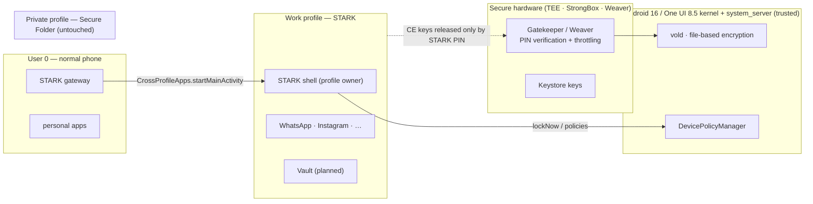
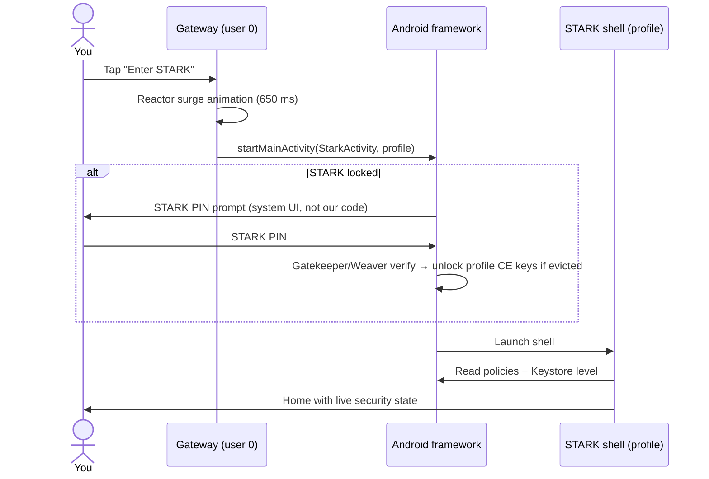
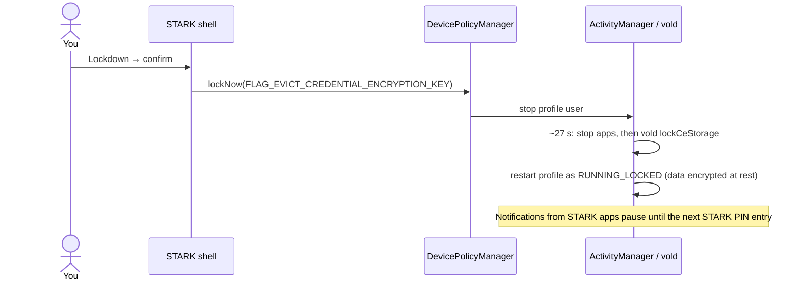
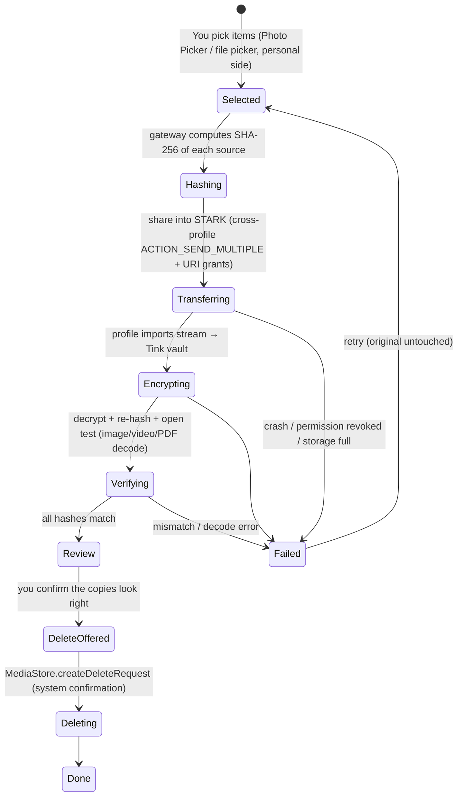

# PROJECT STARK — Architecture & Plan (Deliverables 4–8)

Status: **v0.1 running on the owner's Galaxy S23 FE** (One UI 8.5, Android 16, patch 2026-08-05)
Date: 2026-10-11 · Companion to [01-feasibility-report.md](01-feasibility-report.md)

Labels: **[VERIFIED-DEVICE]** observed on the S23 FE · **[DOCUMENTED]** official Android docs/AOSP · **[PLANNED]** design not yet built · **[TO VERIFY]** needs a device test before we rely on it.

---

## ⚠️ Architecture change, v0.3 (2026-10-11): STARK-owned lock

**Owner decision:** replace Android's separate work-profile PIN screen, which can't be restyled, with STARK's own HUD lock. Apps may be marked "Always live" individually.

| Aspect | v0.1–0.2 (Android work challenge) | **v0.3 (STARK lock)** |
|---|---|---|
| Unlock UI | Generic Android PIN page | STARK HUD keypad |
| What gates STARK's apps | Android: profile CE keys need the STARK PIN | Profile owner **suspends** every app while locked (`setPackagesSuspended`) and **blocks installs** (`DISALLOW_INSTALL_APPS`) [VERIFIED-DEVICE] |
| PIN verification | Gatekeeper/Weaver in the TEE | PBKDF2-HMAC-SHA256 (600k) → HMAC with a non-exportable **StrongBox** key (`setUnlockedDeviceRequired`) → constant-time compare. App-enforced delays: 4 free tries, then 30 s doubling to 1 h, which survive reboot |
| Someone with your **phone PIN** (T2) | Can't decrypt STARK's app data | Can't open paused apps, STARK's shell or (future) vault. **Can** open always-live apps. With root or forensic tools they could read third-party app data, because profile storage now unlocks with the phone PIN |
| Auto-lock | Every screen lock (Android) | Sentinel service on screen-off, plus a direct-boot receiver at boot, plus on app update |
| Lockdown | Evicts profile keys | Pauses apps, evicts profile keys and locks the phone. The next unlock needs the phone PIN on the normal keyguard |
| Known gap | — | Play Store can't be suspended (system installer). Mitigated by the install block. |
| Requires | — | Android's "Use one lock" turned **on** for the work profile, otherwise both PIN screens appear |

The T1/T2 rows below describe the v0.2 design. Read them together with this table until the full threat model is revised.

---

## Deliverable 4: Threat model

### Assets

| ID | Asset | Where it lives |
|---|---|---|
| A1 | Data of apps inside STARK (WhatsApp, Instagram, …) | STARK profile CE storage |
| A2 | STARK vault: photos, files, notes **[PLANNED]** | STARK profile CE storage, Tink-encrypted on top |
| A3 | STARK PIN | Owner's memory. Android stores only a hardware-protected verifier. |
| A4 | Recovery code **[PLANNED]** | Owner's offline copy only |
| A5 | Metadata: that STARK exists, which apps it holds, notification content | Launcher, Settings, notification shade |

### Attackers and outcomes

| # | Attacker | Control | Evidence | Residual risk |
|---|---|---|---|---|
| T1 | Casual user of your unlocked phone | STARK PIN on entry; **Lock** button; Android re-locks STARK when the screen locks | Lock → PIN required [VERIFIED-DEVICE] | They see that STARK exists (A5) |
| T2 | Someone who knows your **phone** PIN | Separate challenge: STARK's CE keys are bound to the STARK PIN | After reboot + phone-PIN unlock, the profile stayed `RUNNING_LOCKED` [VERIFIED-DEVICE] | They can **delete** STARK from Settings (data destroyed, not read) |
| T3 | Malicious app on the personal side | Android user/profile isolation and the app sandbox | [DOCUMENTED] | Platform bugs |
| T4 | Accidental exposure | Screen capture blocked [VERIFIED-DEVICE], copy-out blocked, lock-screen redaction, contacts hidden, Recents thumbnail disabled | Policy values read back on the Security screen | Apps inside STARK choose their own notification text while it's unlocked |
| T5 | Thief with the **locked** phone | FBE + hardware-bound keys. **Lockdown** evicts STARK keys. | `vold lockCeStorage(10)` after Lockdown [VERIFIED-DEVICE] | In "Lock" (not Lockdown) state, STARK keys stay in RAM until reboot |
| T6 | Rooted or compromised OS | **Out of scope** | — | Full exposure while STARK is unlocked |
| T7 | Forensic lab | Before-first-unlock and Lockdown states hold only encrypted data | — | Exploits against the unlocked phone, or memory attacks while keys are loaded |

### Security boundaries



### Assumptions

1. Samsung's kernel, TEE and StrongBox behave as Android documents. The bootloader stays **locked** (`verifiedbootstate=green` verified).
2. Monthly security patches keep being installed.
3. The STARK PIN is **unique**: not your phone PIN, not used elsewhere, at least 6 digits.
4. Biometrics for STARK are a trade-off you'll decide in M2. A fingerprint enrolled for STARK lets that finger in without the PIN.

---

## Deliverable 5: System architecture

### Components (as built in v0.1)

| Module | File(s) | Responsibility |
|---|---|---|
| Entry / role switch | `StarkActivity.kt` | One launcher activity. It acts as the **shell** when it's profile owner and as the **gateway** otherwise. |
| Gateway | `gateway/Gateway.kt`, `GatewayScreen.kt` | Reads STARK's state from the personal side; provisions; enters via `CrossProfileApps` |
| Policy | `admin/StarkPolicy.kt` | The **only** caller of `DevicePolicyManager`: baseline protections, Lock, Lockdown, state read-back |
| Provisioning | `admin/StarkAdminReceiver.kt`, `ProvisioningActivities.kt` | Android 12+ provisioning contract; applies the baseline on creation |
| Security model | `security/SecurityState.kt`, `KeyHardware.kt` | Pure, unit-tested rules that turn real values into OK, Advisory or Critical. Measures key hardware. |
| Shell UI | `shell/*` | Boot sequence, PIN-setup gate, home/launcher, security screen, Lockdown dialog |
| Design system | `ui/*` | Palette, type, `ArcReactor` (procedural Canvas), panels, buttons |

### Authentication flow: entering STARK



### Lockdown flow



### Storage design

| Layer | Status | Design |
|---|---|---|
| Profile CE storage | **Live** | All STARK app data. Keys are bound to the STARK PIN (verified). |
| Vault encryption | [PLANNED M3] | **Google Tink** `StreamingAead` (AES256-GCM-HKDF, 1 MB segments). The keyset is wrapped by an Android Keystore AES-256 key (StrongBox, falling back to TEE) with `setUnlockedDeviceRequired(true)`. Random file names; metadata in Room. Never in MediaStore. |
| Backup | **Live** | `allowBackup=false` + data-extraction rules exclude everything (cloud and device transfer) |
| Export | [PLANNED M3] | User-initiated encrypted archive. The key is derived from a separate export passphrase with **Argon2id** (maintained library chosen at M3). |

**Key-loss consequences:** if the profile is removed, or the STARK PIN *and* the recovery code are both lost, the vault keys are gone permanently. Only an encrypted export you made yourself can restore the data.

### Recovery design [PLANNED M2, TO VERIFY]

1. STARK generates 32 random bytes and calls `setResetPasswordToken`. It shows them once as a grouped base32 code, and you confirm by re-typing a group.
2. The token is activated by confirming the current STARK PIN (`createConfirmDeviceCredentialIntent`).
3. **Reset path:** the work-challenge lock intercepts every activity in a locked profile, so recovery must start from the **gateway**. STARK whitelists its own package (`setCrossProfilePackages`), and you grant "Connected apps". The gateway then binds to a direct-boot-aware service in the profile, which calls `resetPasswordWithToken`. *This must be proven on-device before we rely on it.*

### Profile-management strategy

- A single work profile, created by DPC-first provisioning. STARK is the profile owner and never device owner.
- Baseline policies are idempotent: applied both on the provisioning broadcast and on every shell start.
- Device-admin policies are declared **before** provisioning, because Android only re-reads them at provisioning or boot (learned in STARK-0).
- Removing STARK means removing the profile (Settings, or a future "Self-destruct" in the shell). The personal side is never touched.

### MOVE workflow [PLANNED M4]



**Invariant:** nothing on the personal side is deleted unless that item's verified hash is recorded in the journal. Every state is persisted, so a crash resumes or rolls back and never loses the only copy. Duplicates are detected by SHA-256 and skipped.

| Data type | Supported mechanism | Limits |
|---|---|---|
| Photos/videos | Photo Picker → share into STARK → vault | Deleting originals needs the system confirmation dialog |
| Documents/downloads | Storage Access Framework → share → vault | Only files you can open; cloud-only files must download first |
| Contacts | Export .vcf on the personal side → import into a contacts app inside STARK | Not a "move"; you remove personal contacts manually |
| Apps | **Install a second instance** inside STARK from its Play Store | That's a fresh install, not a move |
| App data / chats | **Only the app's own mechanism**: WhatsApp linked device or chat transfer, Instagram re-login | STARK can't and won't read another app's private database |

---

## Deliverable 6: Roadmap and acceptance criteria

| Milestone | Scope | Acceptance criteria | Status |
|---|---|---|---|
| **M0 Feasibility** | STARK-0 probe | U2/U3/U4/U6 pass on device; U5 passes for WhatsApp | ✅ Done |
| **M1 Shell v0.1** | Provisioning, PIN gate, home/launcher, Security screen, Lock, Lockdown, baseline policies | Profile created beside Secure Folder; separate PIN enforced; Lock → PIN required; screenshots blocked; 6/6 unit tests green; no crashes | ✅ Done (Lockdown from the shell still to be re-run on the v0.1 build) |
| **M2 Recovery + hardening** | Recovery code, biometric decision, auto-Lockdown (idle N h / schedule), AGP + targetSdk 36 upgrade | Reset with the correct code works from the gateway; a wrong code fails with no lockout of the real PIN; auto-Lockdown fires within ±1 min; the release build passes lint | Next |
| **M3 Vault** | Encrypted gallery, files, notes | Ciphertext only on disk (verified by pulling the files); vault key unusable while STARK is locked; 1 GB video streams without full decryption; nothing indexed by MediaStore | Planned |
| **M4 MOVE** | Transactional migration | 100% of the interruption tests in D7 leave at least one verified copy; no delete before verify; duplicates skipped | Planned |
| **M5 Apps & notifications** | WhatsApp/Instagram setup guide, notification behaviour per lock level | Documented behaviour of each app in Lock vs Lockdown, measured on device | Planned |
| **M6 Polish** | Motion, accessibility, battery | TalkBack labels everywhere; works at 200% font; Reduced Motion honoured; < 1% battery/hour with the shell in the background | Planned |
| **M7 Security review + release** | Threat-model test pass, release signing, R8 | Every T1–T5 control re-tested on the release build; signing key stored offline | Planned |

---

## Deliverable 7: Testing strategy

| Layer | What | How |
|---|---|---|
| Unit (JVM) | `SecurityState` rules ✅, MOVE state machine, hash journal, recovery-code format | `./gradlew testDebugUnitTest` |
| Instrumentation | Shell UI, policy toggles | Emulator with a work profile (`pm create-user --profileOf 0 --managed` + `dpm set-profile-owner`), because `adb` is blocked inside the real profile by design |
| Physical device | Every row of the threat table | `adb` evidence scripts reading `dumpsys user`, `dumpsys lock_settings`, the `vold` log and `screencap` (the STARK-0 method) |
| Security | Phone PIN can't open STARK; BFU after reboot; Lockdown eviction and timing; screenshot/copy/redaction; vault files unreadable when pulled; backup exclusion; Recents thumbnail blank | Scripted checklist per release |
| Migration interruption | Kill the process in every MOVE state; revoke the URI grant mid-copy; fill storage; reboot mid-copy; import duplicates | The original must survive every case |
| Recovery | Correct code, wrong code, code reuse, profile removal → restore from export | Device-only |

---

## Deliverable 8: Repository and tooling plan

```
Shaikh OS/
├── app/                      # STARK (single module until M3)
│   └── src/main/java/dev/shaikh/stark/{admin,gateway,security,shell,ui}
├── experiments/stark0-probe/ # feasibility probe (kept for reference, not shipped)
├── docs/                     # 01 feasibility · 02 architecture & plan
└── gradle/ …
```

- **Toolchain (pinned):** Gradle 8.9, AGP 8.7.3, Kotlin 2.0.21, Compose BOM 2024.12.01, compileSdk/targetSdk 34, minSdk 31, JDK 21. Upgrading to AGP 8.12+ and targetSdk 36 is an M2 task.
- **Planned dependencies:** Tink (vault), Room (vault index, MOVE journal), WorkManager (auto-Lockdown). Each gets reviewed when added.
- **Git:** this folder **isn't a git repository yet**. Recommended: `git init`, commit v0.1 as the baseline, one branch per milestone, `main` always installable. Never commit signing keys; `.gitignore` is already in place.
- **Division of work:**
  - **Claude Code**: implementation, unit tests, `adb` evidence scripts, device verification, docs.
  - **Android Studio**: Layout Inspector and Profiler (frame time, battery), emulator work-profile instrumentation tests, release signing.
  - **Antigravity Pro**: design exploration (screens for the vault and MOVE), research spikes such as the recovery binding path, and roadmap reviews.
